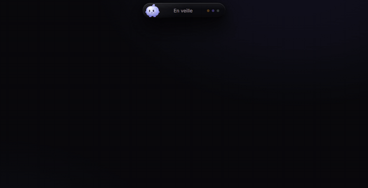

# îlot

Une petite île posée sur ton écran Windows. Elle te montre ce que font tes agents IA, te laisse répondre à leurs demandes sans changer de fenêtre, affiche tes messages et pilote ta musique. Mochi, une petite mascotte, y vit et réagit à ce qui se passe.



[Voir la vidéo de démo (54 s)](media/ilot-demo.mp4)

## Ce qu'elle fait

- **Agents IA** : Claude Code, Gemini CLI, Codex, Copilot CLI, OpenCode et d'autres. Un point par IA, ce que chacune modifie (`+12 −3`), et une session en direct avec ses étapes et son diff.
- **Permissions** : la commande exacte et son niveau de risque, puis **Autoriser** ou **Refuser**. îlot ne répond jamais à ta place : sans réponse, l'agent te repose la question dans son terminal.
- **Questions des agents** : réponds dans l'île, ou dans le terminal si tu préfères.
- **Messages** : WhatsApp, Discord et les autres notifications Windows, avec réponse rapide.
- **Musique et vidéo** : Spotify, YouTube et les autres lecteurs Windows, avec mini-lecteur, barre de progression et volume à la molette.
- **Chat** : Claude, Gemini, OpenAI ou un modèle local (Ollama, LM Studio). Dépose un fichier sur Mochi pour lui poser une question dessus.
- **Pastilles** : GitHub, GitLab, Vercel, Stripe et d'autres services, en lecture seule, ajoutés un par un.
- **Mochi** : il respire, te suit des yeux, danse avec la musique, sort se balader sur le bureau et change de tenue avec les saisons.
- **Réglages** : thèmes, raccourcis globaux, plusieurs écrans, français et anglais.

## Installer

Il faut Node.js, Rust et les prérequis de [Tauri 2](https://tauri.app/start/prerequisites/) pour Windows.

```powershell
npm install
npm run tauri build
```

1. Lance l'installeur créé dans `target\release\bundle\nsis\`. Il s'installe pour ton compte, sans droits administrateur.
2. La pilule apparaît en haut de l'écran.
3. Dans **Réglages › Agents**, branche les IA que tu utilises. Rien n'est branché sans ton clic, et la config d'origine est sauvegardée à côté (`.avant-ilot`).

## Confidentialité

- Aucune télémétrie, aucun compte, aucun serveur.
- Les agents parlent à îlot par un canal local réservé à ton compte Windows. Aucun port réseau n'est ouvert.
- Les clés API sont rangées dans le Gestionnaire d'identification Windows, jamais en clair.
- Le contenu de tes messages n'est jamais écrit sur le disque.

## Licence

[MIT](LICENSE)
